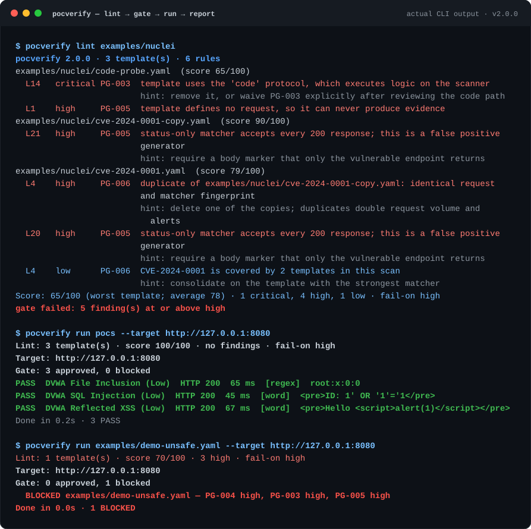

# PoCVerify 2.0

**Lint before you run.**

Most PoC collections stop at *"it works on my machine"*. PoCVerify treats every
PoC as untrusted code and puts a static gate in front of the runner:

```text
lint  →  gate  →  run  →  report
```

[](https://github.com/xiangfuhua/poc-verify/actions/workflows/ci.yml)
[](https://www.python.org/)
[](LICENSE)



Templates that fail the gate are **refused by the runner** — not "warned
about". That is the whole point: a PoC that drops a table or executes JavaScript
on the scanner should never run just because it parsed.

## Why

- **Collections accumulate duplicates.** The same CVE arrives in five variants,
  each one multiplying request volume and alert noise.
- **`status: 200` is not a vulnerability detector.** A matcher that any healthy
  page satisfies turns a scanner into a false-positive generator.
- **`nuclei -validate` only says a template loads.** It does not say whether the
  template is safe, maintainable, or worth running.

## What it checks

| Rule | Catches | Default |
| --- | --- | --- |
| `PG-001` | Missing id/author/severity/reference, bad CVSS, non-URL references | high |
| `PG-002` | Bad id format, filename ≠ id, duplicate ids, CVE mismatch, duplicate YAML keys | high |
| `PG-003` | `code` / `javascript` / `file` / `headless`, CRLF headers, absolute URLs, `unsafe: true` | critical |
| `PG-004` | `DROP TABLE`, `DELETE` without `WHERE`, `rm -rf`, time-based probes, huge/opaque payloads | high |
| `PG-005` | No matchers, status-only 200, `.*` regexes, negative-only conditions, unverifiable types | high |
| `PG-006` | Cross-file duplicate fingerprints, same endpoint, same CVE in several templates | high |

Full details, examples and false-positive notes: [`docs/rules.md`](docs/rules.md).

Every finding has a file and line (`pocs/x.yaml:12`), a severity, a hint, and a
stable rule id. Findings are weighted into a score:

```text
score = max(0, 100 - 25*critical - 10*high - 4*medium - 1*low)
```

## Quick start

```bash
pip install -e .
pocverify lint pocs                       # static only, no network
pocverify lint pocs --format sarif -o pocverify.sarif
pocverify rules
```

Execute against your own lab (the bundled mock target is intentionally
vulnerable):

```bash
# terminal 1 — Flask is only needed for the mock target
pip install -e ".[mock]"
python mock/dvwa_mock.py

# terminal 2
pocverify run pocs --target http://127.0.0.1:8080
pocverify run pocs --target http://127.0.0.1:8080 --dry-run   # print requests, send nothing
```

The gate in action:

```console
$ pocverify run examples/demo-unsafe.yaml --target http://127.0.0.1:8080 --no-report
Lint: 1 template(s) · score 70/100 · 3 high · fail-on high
Target: http://127.0.0.1:8080
Gate: 0 approved, 1 blocked
  BLOCKED examples/demo-unsafe.yaml — PG-004 high, PG-003 high, PG-005 high
Done in 0.0s · 1 BLOCKED
```

Nothing was sent. `--allow-unsafe` is required to override, and the reason is
that a human decided to, not that the tool gave up.

## GitHub Actions

```yaml
- run: pip install .
- run: pocverify lint pocs --format sarif -o pocverify.sarif --fail-on high
- uses: github/codeql-action/upload-sarif@v3
  if: always()
  with:
    sarif_file: pocverify.sarif
```

`--fail-on high` fails the job; waived findings are uploaded as SARIF
suppressions, so accepted risk stays visible instead of disappearing.

## Waivers are decisions, not mutes

```yaml
# .pocverify.yaml
version: 1
ignore:
  - rule: PG-005
    file: "pocs/legacy/*.yaml"
    reason: "legacy status-only checks, tracked in issue #12"
lint:
  fail-on: high
  fail-under: 80
gate:
  block-on: high
```

A reason is mandatory. An entry that stops matching is reported as an *unused
waiver*, and `--strict-waivers` turns that into a failure — otherwise the config
silently rots.

## Two dialects, one model

| | Native | Nuclei |
| --- | --- | --- |
| Metadata | flat v1 fields or `info:` | `info:` |
| Request | `method` / `path` / `payload` / `headers` | `http:` list, `raw:`, `payloads:` |
| Matchers | `status` / `word` / `regex` / `size` / `dsl` | same, plus unsupported types flagged |
| Protocols | — | `code`, `javascript`, `file`, `headless`, `network` ... |

Legacy v1 templates (`match_status`, `match_keyword`, `match_regex`) still load,
so an existing collection does not need a migration before it can be linted.
`main.py` remains as a deprecated shim for the v1 CLI.

## Design and threat model

The static-first design is deliberate: a template is executable content from a
stranger, so the tool refuses to execute what it has not read. See
[`docs/architecture.md`](docs/architecture.md) for the pipeline, the line-index
implementation, the redirect/URL scope rules and the failure-mode table.

Safety properties enforced in code, not just documented:

- lint sends no request and executes no template code;
- absolute URLs must be same-origin unless `--allow-unsafe` is passed;
- cross-origin redirects are not followed;
- `Host` in raw requests is replaced by the target;
- response bodies are capped, credentials are masked in previews.

## Limitations

- Nuclei DSL support is a subset: flat `&&` / `||`, `status_code`, `contains*`,
  `regex`, `len(body)`; anything else is reported instead of guessed.
- `payloads` expand to at most 50 combinations.
- No authentication flow, no concurrency beyond `--delay`.
- Static analysis cannot prove a template is *correct*, only that it is not
  obviously unsafe, duplicated, or unmaintainable.

## Roadmap

- `pocverify baseline` to record and compare scores over time.
- Rule severity profiles per environment (internal lab vs. public collection).
- Optional concurrency with a global request budget.

## Development

```bash
pip install -e ".[dev]"
pytest -q
```

188 tests, no network required: the runner tests use a local `http.server`
fixture. See [`CHANGELOG.md`](CHANGELOG.md) for the 2.0 changes.

## License

MIT. See [`SECURITY.md`](SECURITY.md) for the authorization and disclosure
policy before pointing this at anything you do not own.
