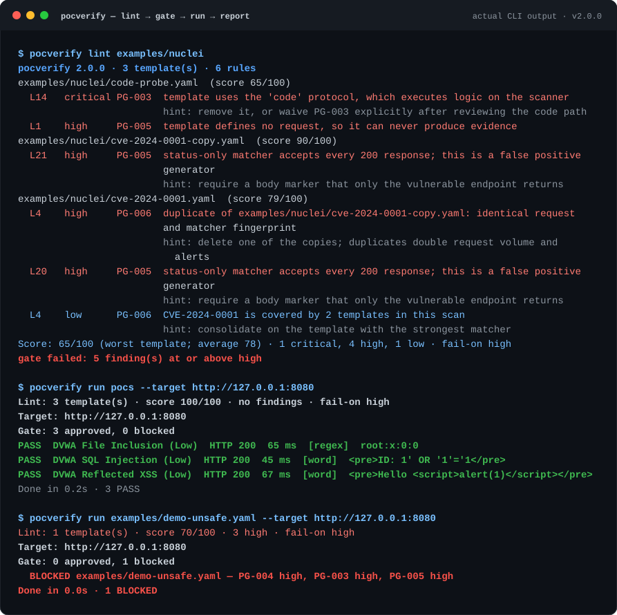

# PoCVerify 2.0

**先检查，再执行。**

多数 PoC 工具停在“在我机器上能跑”。PoCVerify 把每一条 PoC 当成不可信代码，在运行器前面放一道静态门禁：

```text
lint（静态检查）→ gate（门禁）→ run（动态验证）→ report（证据报告）
```



没通过门禁的模板，运行器会**拒绝执行**，而不是打印一条警告后照跑。这就是它存在的理由：一条会删表、或在扫描机上执行 JavaScript 的 PoC，不应该因为“YAML 能解析”就被放行。

## 为什么做这个

- **模板库会重复堆积**：同一个 CVE 出现五份变体，请求量和告警量都翻倍。
- **`status: 200` 不是漏洞检测**：任何正常页面都能满足的匹配条件，只会制造误报。
- **`nuclei -validate` 只说明模板能加载**：它不判断模板是否安全、可维护、值得运行。

## 检查什么

| 规则 | 拦截的问题 | 默认级别 |
| --- | --- | --- |
| `PG-001` | 缺 id/作者/危害等级/参考链接、CVSS 越界、参考链接不是 URL | high |
| `PG-002` | id 格式错误、文件名与 id 不一致、id 重复、CVE 信息矛盾、YAML 重复键 | high |
| `PG-003` | `code` / `javascript` / `file` / `headless`、CRLF 头注入、绝对 URL、`unsafe: true` | critical |
| `PG-004` | `DROP TABLE`、无 `WHERE` 的 `DELETE`、`rm -rf`、时间盲注、超大/混淆 payload | high |
| `PG-005` | 没有 matcher、只匹配 200、`.*` 正则、全 negative、运行器无法验证的类型 | high |
| `PG-006` | 跨文件重复指纹、同端点不同匹配、同一 CVE 多份模板 | high |

完整规则、示例与误报说明见 [`docs/rules.md`](docs/rules.md)。

每条结果都带文件与行号（`pocs/x.yaml:12`）、级别、修复提示和固定规则编号。评分方式：

```text
score = max(0, 100 - 25*critical - 10*high - 4*medium - 1*low)
```

## 快速开始

```bash
pip install -e .
pocverify lint pocs                       # 只做静态检查，不发请求
pocverify lint pocs --format sarif -o pocverify.sarif
pocverify rules
```

对本地靶场执行（仓库自带一个故意有漏洞的 mock 靶场）：

```bash
# 终端 1（mock 靶场需要 Flask）
pip install -e ".[mock]"
python mock/dvwa_mock.py

# 终端 2
pocverify run pocs --target http://127.0.0.1:8080
pocverify run pocs --target http://127.0.0.1:8080 --dry-run   # 只打印请求，不发送
```

门禁长这样：

```console
$ pocverify run examples/demo-unsafe.yaml --target http://127.0.0.1:8080 --no-report
Lint: 1 template(s) · score 70/100 · 3 high · fail-on high
Target: http://127.0.0.1:8080
Gate: 0 approved, 1 blocked
  BLOCKED examples/demo-unsafe.yaml — PG-004 high, PG-003 high, PG-005 high
Done in 0.0s · 1 BLOCKED
```

这条模板一个请求都没发出去。要放行必须显式加 `--allow-unsafe`——那是人做出的决定，不是工具妥协。

## 接入 GitHub Actions

```yaml
- run: pip install .
- run: pocverify lint pocs --format sarif -o pocverify.sarif --fail-on high
- uses: github/codeql-action/upload-sarif@v3
  if: always()
  with:
    sarif_file: pocverify.sarif
```

`--fail-on high` 会让 CI 变红；被豁免的 finding 以 SARIF suppression 上传，所以“接受的风险”仍然可见，而不是消失。

## 豁免是决策，不是静音

```yaml
# .pocverify.yaml
version: 1
ignore:
  - rule: PG-005
    file: "pocs/legacy/*.yaml"
    reason: "legacy status-only checks, tracked in issue #12"
lint:
  fail-on: high
  fail-under: 80
gate:
  block-on: high
```

`reason` 是必填的。已经匹配不到任何东西的豁免会被报告为 *unused waiver*，加 `--strict-waivers` 直接失败——否则配置文件会悄悄腐烂。

## 两套方言，一个模型

| | 原生格式 | Nuclei |
| --- | --- | --- |
| 元数据 | v1 扁平字段或 `info:` | `info:` |
| 请求 | `method` / `path` / `payload` / `headers` | `http:` 列表、`raw:`、`payloads:` |
| 匹配 | `status` / `word` / `regex` / `size` / `dsl` | 同上，不支持的类型会被标记 |
| 协议 | — | `code`、`javascript`、`file`、`headless`、`network` 等 |

v1 旧模板（`match_status`、`match_keyword`、`match_regex`）仍可加载，不必先迁移才能做检查。`main.py` 作为 v1 CLI 的弃用兼容入口保留。

## 设计与威胁模型

“静态优先”是刻意的：模板是陌生人写的可执行内容，工具不执行自己没读过的东西。流水线、行号索引、URL 与重定向的作用域规则、失败模式表见 [`docs/architecture.md`](docs/architecture.md)。

这些安全属性写在代码里，而不只是文档里：

- lint 不执行模板代码、不发任何请求；
- 绝对 URL 必须与目标同源，否则要显式 `--allow-unsafe`；
- 跨源重定向不跟随；
- raw 请求里的 `Host` 一律替换为目标；
- 响应体有上限，预览里的凭据打码。

## 已知限制

- Nuclei DSL 只支持子集：扁平的 `&&` / `||`、`status_code`、`contains*`、`regex`、`len(body)`；其余直接报错而不是猜。
- `payloads` 最多展开 50 种组合。
- 没有自动登录，也没有并发控制（只有 `--delay`）。
- 静态分析不能证明模板“正确”，只能证明它没有明显不安全、不重复、不是不可维护。

## 开发

```bash
pip install -e ".[dev]"
pytest -q
```

188 个测试，全部离线：运行器测试使用本地 `http.server`，不访问外网。2.0 的变更见 [`CHANGELOG.md`](CHANGELOG.md)。

## 许可

MIT。把工具指向任何目标之前，先读 [`SECURITY.md`](SECURITY.md) 里的授权与披露约定。
